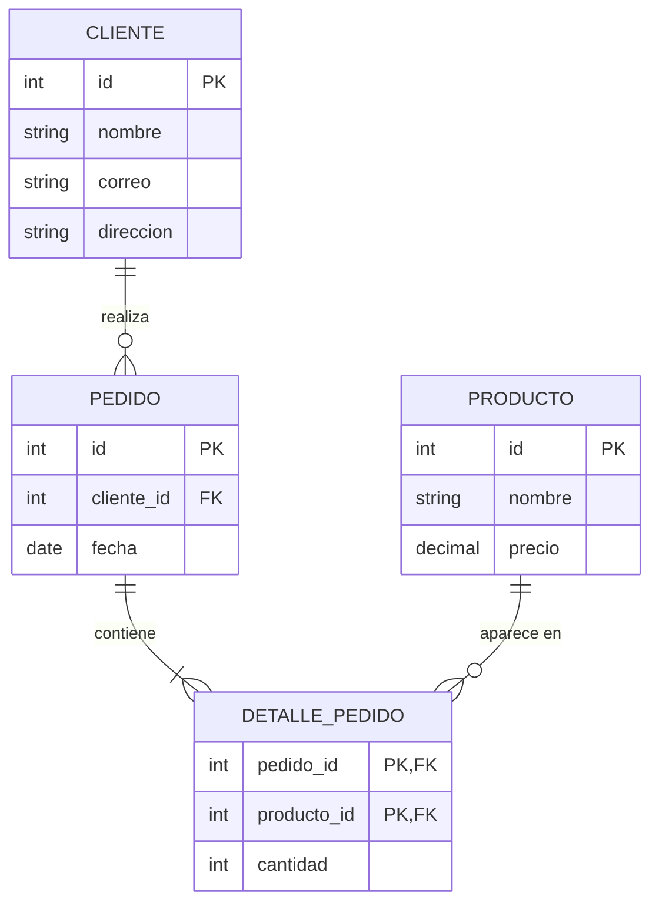

# Práctica 2 – Modelado de datos con el modelo entidad-relación

## Objetivo
Identificar entidades, atributos y relaciones en un contexto, construir diagramas entidad-relación (ER) y traducirlos a un esquema relacional.

## Actividad guiada: sistema de ventas

### Diagrama ER



### Esquema relacional

- **cliente**(<u>id</u>, nombre, correo, direccion)
- **producto**(<u>id</u>, nombre, precio)
- **pedido**(<u>id</u>, *cliente_id* → cliente, fecha)
- **detalle_pedido**(<u>*pedido_id*</u> → pedido, <u>*producto_id*</u> → producto, cantidad)

Script: [`practica-02.sql`](practica-02.sql).

### Decisiones
- **Cliente – Pedido (1:N):** un cliente puede hacer muchos pedidos y cada pedido pertenece a un solo cliente, así que la clave foránea `cliente_id` va en `pedido`.
- **Pedido – Producto (N:M):** un pedido tiene varios productos y un producto aparece en muchos pedidos. Se resolvió con la tabla intermedia `detalle_pedido`, que además guarda la `cantidad` (un atributo de la relación, no de ninguna de las dos entidades).
- La clave primaria de `detalle_pedido` es compuesta (`pedido_id`, `producto_id`) para que un producto no se repita dentro del mismo pedido.
- Se agregaron `CHECK` para no aceptar precios negativos ni cantidades en cero.

### Pruebas
La salida completa está en [`evidencia/salida-psql.txt`](evidencia/salida-psql.txt).

1. Consulta que une las cuatro tablas y muestra cada pedido con su cliente y productos:
   ```
    pedido |  cliente   | producto | cantidad
   --------+------------+----------+----------
         1 | Ana López  | Mouse    |        2
         1 | Ana López  | Teclado  |        1
         2 | Luis Pérez | Monitor  |        1
   ```
2. Insertar un pedido para un cliente que no existe (`cliente_id = 99`) es **rechazado** por la clave foránea. Este error es el resultado esperado de la prueba:
   ```
   ERROR:  insert or update on table "pedido" violates foreign key constraint "pedido_cliente_id_fkey"
   ```

## Reto: gestión de clínicas
Diagramas ER de Paciente, Médico, Cita y Especialidad en tres notaciones (pata de gallo, UML y flechas) y su esquema relacional hecho en dbdiagram.io. Documento: [`evidencia/reto-practica-02.pdf`](evidencia/reto-practica-02.pdf).

## Errores encontrados
- Al principio la relación Pedido–Producto se puede modelar como 1:N, pero un pedido con varios productos obliga a repetir el pedido; por eso debe ser N:M con tabla intermedia.
- La `cantidad` no puede ir en `producto` ni en `pedido`: depende de ambos, así que pertenece a `detalle_pedido`.

## Conclusión
El diagrama ER ayuda a entender el contexto antes de escribir SQL, y el esquema relacional lo vuelve explícito: cada entidad se convierte en tabla, las relaciones 1:N en claves foráneas y las N:M en tablas intermedias. Las restricciones (`PRIMARY KEY`, `REFERENCES`, `CHECK`) hacen que la base rechace datos que no respetan el modelo.
