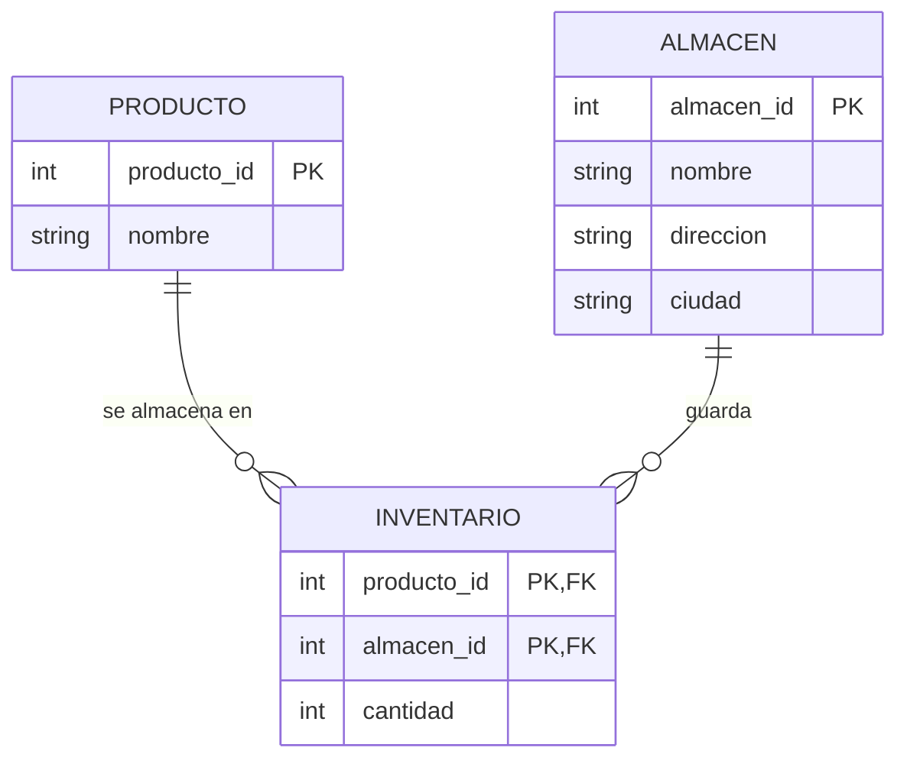
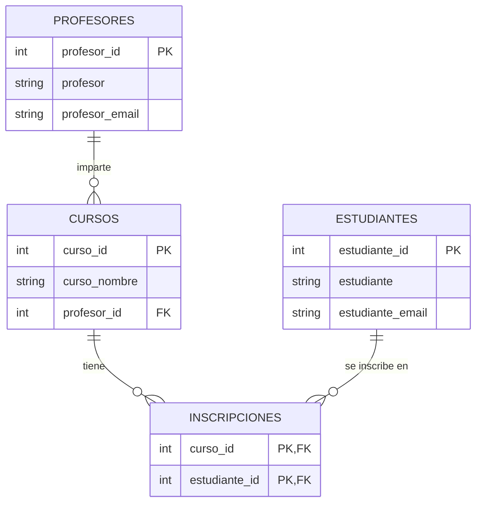

# Práctica 3 – Normalización y claves

## Objetivo
Llevar tablas hasta la tercera forma normal (3FN) para evitar redundancia y anomalías, e identificar claves primarias, compuestas y foráneas.

Script: [`practica-03.sql`](practica-03.sql). En las dos partes se conserva la tabla original con datos de ejemplo y se migran los datos a las tablas normalizadas con `INSERT ... SELECT`, para comprobar que no se pierde información.

## Parte A – Actividad guiada: Inventario

Tabla original: `inventario(id, producto, almacen, cantidad, direccion_almacen, ciudad_almacen)`

### Análisis
- **1FN:** todos los valores son atómicos y hay clave primaria (`id`). ✔
- **Redundancia:** la dirección y la ciudad del almacén se repiten en cada fila de ese almacén (en los datos de prueba, "Almacén Norte" aparece 3 veces con la misma dirección).
- **Dependencia transitiva (viola 3FN):** `id → almacen → direccion_almacen, ciudad_almacen`.
- **Anomalías:** cambiar la dirección de un almacén obliga a modificar varias filas (actualización); no se puede registrar un almacén sin productos (inserción); al borrar el último producto de un almacén se pierde su dirección (eliminación).

### Resultado en 3FN



- La `cantidad` depende del producto **y** del almacén, por eso `inventario` usa la clave compuesta (`producto_id`, `almacen_id`) y el `id` original deja de ser necesario.
- La dirección y la ciudad se guardan una sola vez en `almacen`.

## Parte B – Reto: Cursos

Tabla original: `cursos(curso_id, curso_nombre, profesor, profesor_email, estudiante, estudiante_email)`, con una fila por cada estudiante inscrito en un curso.

### Análisis paso a paso
1. **Clave real.** `curso_id` se repite (un curso tiene varios estudiantes), así que no identifica la fila por sí solo. La clave es compuesta: (`curso_id`, `estudiante_email`).
2. **1FN:** los valores son atómicos y existe la clave compuesta. ✔
3. **2FN – dependencias parciales** (atributos que dependen solo de una parte de la clave):
   - `curso_id → curso_nombre, profesor, profesor_email`
   - `estudiante_email → estudiante`

   Se separan en `cursos` y `estudiantes`, y la relación N:M queda en `inscripciones`.
4. **3FN – dependencia transitiva:** `curso_id → profesor_email → profesor`. Los datos del profesor no dependen del curso sino del profesor, así que se mueven a `profesores` y `cursos` guarda solo `profesor_id`.

### Diagrama ER resultante



### Decisiones
- Los correos (`profesor_email`, `estudiante_email`) son **claves candidatas** y se declararon `UNIQUE`; como clave primaria se usó un `SERIAL` porque un correo puede cambiar.
- Se crearon primero las tablas nuevas y se migraron los datos, en lugar de borrar columnas de la tabla original con `ALTER TABLE ... DROP COLUMN`, que elimina los datos.

## Pruebas
La salida completa está en [`evidencia/salida-psql.txt`](evidencia/salida-psql.txt).

1. **Redundancia detectada** en la tabla original de inventario (consulta `GROUP BY`): "Almacén Norte" repetido 3 veces y "Almacén Sur" 2 veces.
2. **Sin pérdida de información:** al unir las tablas normalizadas se reconstruyen exactamente las 5 filas originales, tanto en Inventario como en Cursos:
   ```
    curso_id |  curso_nombre  |   profesor    | estudiante
   ----------+----------------+---------------+-------------
           1 | Bases de Datos | Carlos Méndez | Ana Torres
           1 | Bases de Datos | Carlos Méndez | Pedro Salas
           2 | Física         | Laura Garza   | Ana Torres
           2 | Física         | Laura Garza   | Sofía Ramos
           3 | Programación   | Carlos Méndez | Pedro Salas
   ```
3. **Anomalía de actualización resuelta:** cambiar la dirección de "Almacén Norte" modifica una sola fila.
4. **Integridad referencial:** inscribir a un estudiante inexistente es rechazado. Este error es el resultado esperado de la prueba:
   ```
   ERROR:  insert or update on table "inscripciones" violates foreign key constraint "inscripciones_estudiante_id_fkey"
   ```

## Errores encontrados
En la primera versión del reto:
- La tabla `Cursos` original tenía `cursos_id SERIAL PRIMARY KEY`. Eso hacía única cada fila y ocultaba que la clave real es compuesta, por lo que las dependencias parciales (2FN) no se veían en el diseño.
- La normalización se hacía con `ALTER TABLE ... DROP COLUMN` sobre la misma tabla: con datos reales se perderían los nombres y correos de profesores y estudiantes.
- La tabla no tenía datos, así que no había forma de probar el resultado.

## Conclusión
Normalizar consiste en preguntarse de qué depende cada atributo: si depende solo de una parte de la clave (2FN) o de otro atributo no clave (3FN), pertenece a otra tabla. Con datos de prueba se comprobó que las tablas normalizadas guardan la misma información sin repetirla, que las anomalías de actualización desaparecen y que las claves foráneas impiden registros inconsistentes.
