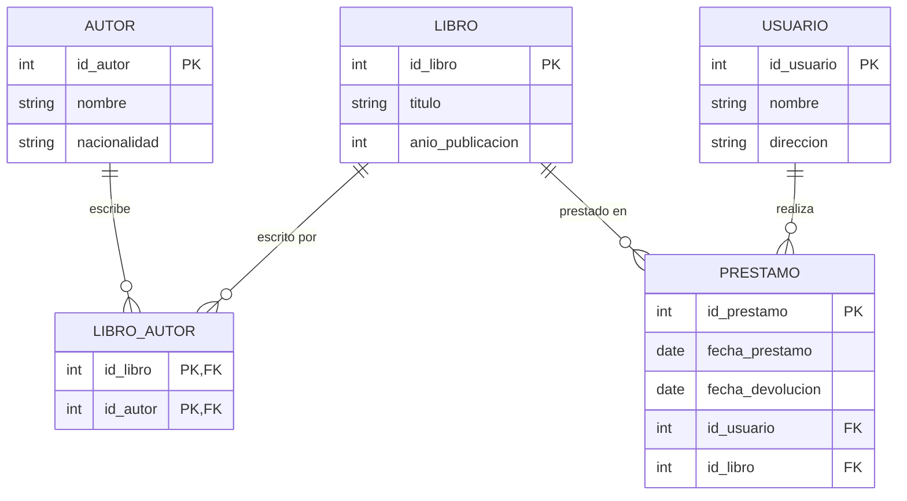

# Práctica 4 – Introducción a SQL y lenguaje de definición de datos (DDL)

## Objetivo
Conocer la sintaxis básica de SQL y sus sublenguajes (DDL, DML, DCL y TCL), y crear y modificar estructuras con `CREATE`, `ALTER` y `DROP`.

Script: [`practica-04.sql`](practica-04.sql). Crea las bases `empresa` (actividad guiada) y `biblioteca` (reto). La base `empresa` se sigue usando en las prácticas 5 a 12.

## Actividad guiada: base empresa

1. Se creó la base `empresa` con las tablas `departamento` (`id`, `nombre`) y `empleado` (`id`, `nombre`, `puesto`, `salario`).
2. Con `ALTER TABLE empleado ADD COLUMN fecha_contratacion DATE;` se agregó la fecha de contratación y se comprobó con `\d empleado`.
3. Se creó la tabla de prueba `prueba_tipos` (entero, decimal, fecha y cadena) para observar cómo PostgreSQL valida los tipos de dato.
4. Se eliminó la tabla de prueba con `DROP TABLE prueba_tipos;` y se comprobó con `\dt` que solo quedan `departamento` y `empleado`.

### Decisiones
- `nombre`, `puesto` y `salario` son `NOT NULL`: un empleado sin esos datos no tiene sentido para la empresa.
- `salario` es `NUMERIC(10,2)` con `CHECK (salario > 0)` para guardar importes exactos y rechazar salarios negativos o en cero.
- El nombre de cada departamento es `UNIQUE` para no registrar el mismo departamento dos veces.
- En `prueba_tipos` la columna decimal se llamó `numero` y no `decimal`, para no usar el nombre de un tipo de dato como nombre de columna.
- La columna `depto_id`, que relaciona al empleado con su departamento, se agrega en la práctica 5, que es cuando se necesita para agrupar.

## Reto: base biblioteca

Tablas normalizadas del modelo de biblioteca de la práctica 2:

### Decisiones
- `libro_autor` resuelve la relación N:M (un libro puede tener varios autores) con clave primaria compuesta.
- `prestamo` guarda las claves foráneas hacia `usuario` y `libro` (relaciones 1:N).
- `fecha_devolucion` puede ser nula (préstamo aún no devuelto), pero si existe no puede ser anterior a `fecha_prestamo` (restricción `CHECK`).

## Pruebas

| Prueba | Resultado esperado | Resultado |
|---|---|---|
| `INSERT` de valores válidos en `prueba_tipos` | Se inserta | ✔ |
| `'veinte'` en una columna `INTEGER` | Error de sintaxis de entrada | ✔ `invalid input syntax for type integer` |
| `123456.78` en `NUMERIC(6,2)` | Error de desbordamiento | ✔ `numeric field overflow` |
| Fecha `'2026-02-30'` | Error de fecha fuera de rango | ✔ `date/time field value out of range` |
| Texto de 21 caracteres en `VARCHAR(10)` | Error de longitud | ✔ `value too long for type character varying(10)` |
| `10.567` en `NUMERIC(6,2)` | Se redondea a `10.57` | ✔ |
| Consulta que une préstamo, usuario, libro y autor | Muestra el préstamo con todos sus datos | ✔ |
| Préstamo con devolución anterior a la fecha de préstamo | Rechazado por el `CHECK` | ✔ `violates check constraint "prestamo_check"` |

Los errores de la tabla son pruebas hechas a propósito para comprobar las restricciones.

Las capturas de la consola están en [`evidencia/`](evidencia/).

## Errores encontrados
- Si el script se ejecuta dos veces, `CREATE DATABASE` falla porque `empresa` y `biblioteca` ya existen; hay que borrarlas antes con `DROP DATABASE`.
- `DROP TABLE` no pide confirmación ni se puede deshacer fuera de una transacción; por eso solo se usó sobre la tabla de prueba.
- PostgreSQL no avisa cuando redondea un decimal a la escala de la columna (`10.567` → `10.57`); hay que elegir bien la escala desde el diseño.

## Conclusión
Con el DDL se define la estructura antes de guardar cualquier dato, y las restricciones (`NOT NULL`, `UNIQUE`, `CHECK`, `REFERENCES`) hacen que la base rechace por sí sola los valores incorrectos. `ALTER TABLE` permite que el diseño evolucione sin perder lo que ya existe, y el reto mostró que un modelo normalizado se traduce directamente a tablas con claves primarias y foráneas.
